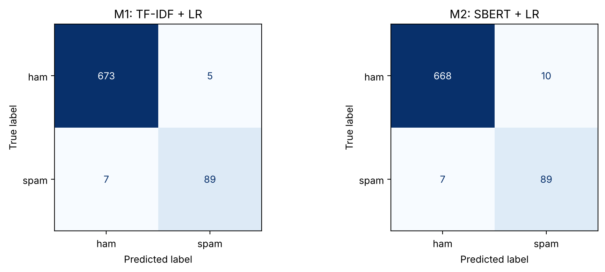
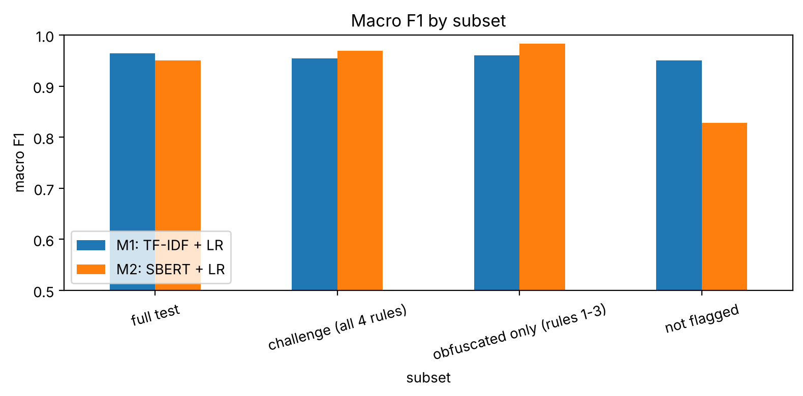
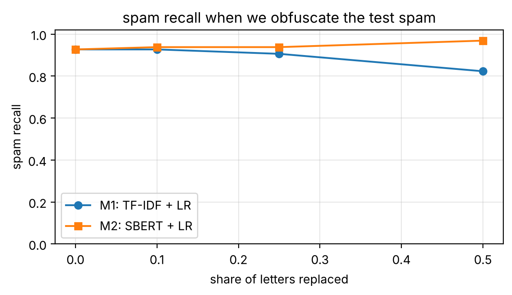

# SMS Spam Detection: TF-IDF vs Sentence-BERT

[](https://colab.research.google.com/github/H7modi77/Project-NLP/blob/main/SMS_Spam_Detection_Group9.ipynb)

**Course:** ARTI 404 - Natural Language Processing (Section 7MA2)
**University:** Imam Abdulrahman Bin Faisal University, College of Computer Science and Information Technology
**Instructor:** Dr. Mohammed Mosuily
**Group:** 9

## Team

| Name | Student ID | Responsibilities |
|---|---|---|
| Mohammed Nasser Almarhoon (team leader) | 2240005893 | Data cleaning and splits, Method 1 (TF-IDF + LR), Method 1 error analysis, two labelled examples |
| Ali Zuhair Alsaffar | 2240005706 | Method 2 (Sentence-BERT + LR), evaluation, Try it, GitHub/Colab, Method 2 error analysis, two labelled examples |

## Project overview

**Task.** The input is one short English SMS message and the output is **Spam** or **Not spam**. Example: *"You won a cash prize. Pay a fee now to claim it"* → Spam.

**Intended users.** Mobile users, telecom providers and small businesses that need to filter unwanted SMS quickly. The system classifies new messages without retraining.

**Methods.** Both methods use the same classifier (Logistic Regression with `class_weight='balanced'`); only the text representation changes.
- **Method 1 (traditional):** TF-IDF word features (unigrams + bigrams)
- **Method 2 (pretrained):** sentence embeddings from `all-MiniLM-L6-v2` (Sentence-BERT), weights frozen

**Research question.** Spammers often hide words with misspellings and obfuscation (fr33, w1n, cl4im, txt, msg), while normal messages can also contain spam-like words such as "free". We ask: *which method detects misspelled or obfuscated spam more reliably?*

## Dataset

UCI SMS Spam Collection [1]: 5,574 English SMS messages (4,827 ham, 747 spam). A copy is kept in [`data/`](data/).

| Step | Result |
|---|---|
| Remove empty rows and exact duplicates (before splitting) | 5,574 → 5,160 messages (4,518 ham, 642 spam) |
| Stratified split 70/15/15, seed 42 | train 3,612 / dev 774 / test 774 |
| Hyperparameter selection | dev set only (`C` for both, `min_df` for TF-IDF) |
| Test set | used once for the final comparison |

## Challenge subset

A test message is flagged if it matches at least one fixed rule:
1. a word that mixes letters and digits (fr33, w1n, 2nite)
2. the same letter 3+ times in a row (sooo, freeee)
3. a token of 3+ letters with no vowels (txt, msg, pls)
4. a spam keyword (free, win, prize, claim, cash, urgent, ...)

205 of the 774 test messages are flagged (81 spam, 124 ham). We also report the stricter *obfuscated only* subset (rules 1-3, 184 messages).

## Results

| Metric | TF-IDF + LR | SBERT + LR |
|---|---|---|
| Accuracy - full test | **0.9845** | 0.9780 |
| Macro F1 - full test | **0.9640** | 0.9501 |
| Macro F1 - challenge subset (205) | 0.9538 | **0.9694** |
| Macro F1 - obfuscated only (184) | 0.9598 | **0.9829** |
| Spam recall - 50% of letters obfuscated (extra test) | 0.823 | **0.969** |

**Answer.** Sentence-BERT is more reliable on misspelled and obfuscated spam, while TF-IDF is slightly better on normal SMS because SBERT gives more false alarms on short messages. An obfuscated word like "cl4im" is unknown to TF-IDF, but the SBERT tokenizer splits it into sub-words and keeps the meaning of the sentence.

<p align="center">
  
</p>
<p align="center">
  
  
</p>

The full error analysis, limitations and our own labelled examples are in the notebook.

## How to run

**Google Colab (recommended):** click the *Open in Colab* badge above, then *Runtime → Run all*. The notebook downloads the dataset and the model by itself and runs on the free CPU runtime in a few minutes.

**Locally:**
```bash
git clone https://github.com/H7modi77/Project-NLP.git
cd Project-NLP
pip install -r requirements.txt
jupyter notebook SMS_Spam_Detection_Group9.ipynb
```

The **Try it** section at the end of the notebook classifies any new SMS with both models without retraining, and handles empty input.

## Repository structure

```
Project-NLP/
├── SMS_Spam_Detection_Group9.ipynb   main notebook (Setup, Data, Method 1, Method 2, Results, Try it, Sources)
├── data/
│   ├── SMSSpamCollection.tsv         UCI SMS Spam Collection
│   └── README.md                     dataset source and license
├── results/                          tables saved by the notebook
│   ├── dev_tuning_tfidf.csv
│   ├── dev_tuning_sbert.csv
│   ├── test_results.csv
│   ├── subset_results.csv
│   ├── leet_test.csv
│   └── test_errors.csv
├── figures/                          plots from the notebook
├── docs/
│   ├── Proposal_Group9.pdf           approved project proposal
│   └── Presentation_Group9.pdf       presentation slides
├── requirements.txt
└── README.md
```

## References

[1] T. A. Almeida, J. M. G. Hidalgo, and A. Yamakami, "Contributions to the study of SMS spam filtering: new collection and results," *Proc. 11th ACM Symposium on Document Engineering (DocEng)*, 2011, pp. 259-262.

[2] N. Reimers and I. Gurevych, "Sentence-BERT: Sentence embeddings using Siamese BERT-networks," *Proc. EMNLP-IJCNLP*, 2019, pp. 3982-3992.
